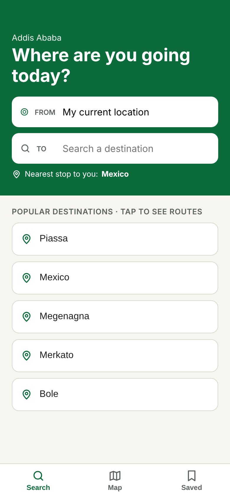
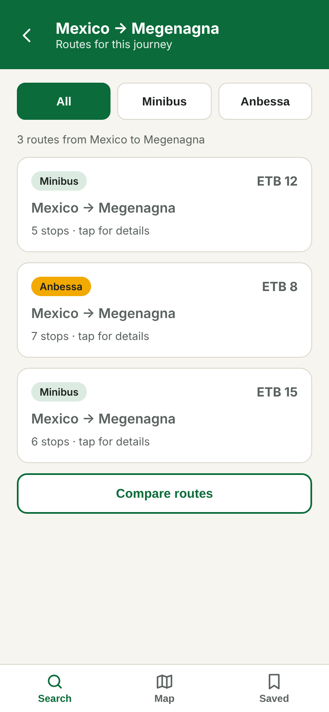
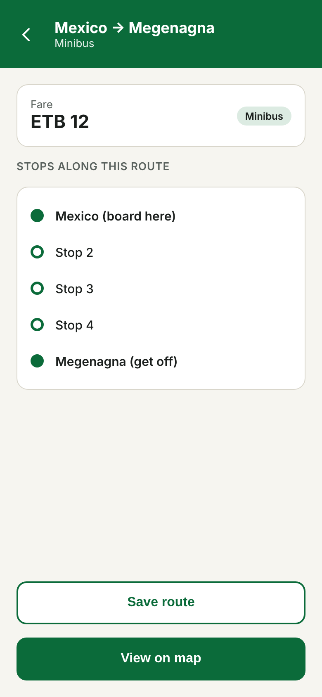
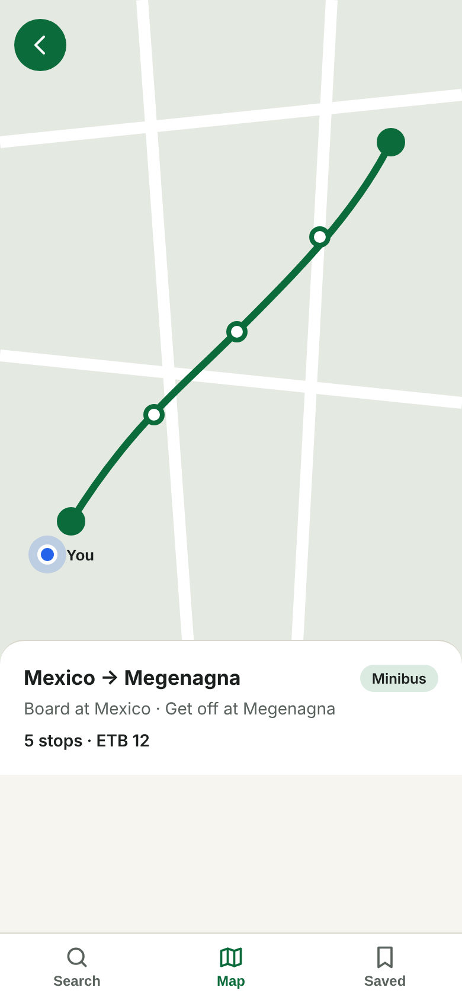

# Project proposal

## 1. Title and one-sentence description

**Minibus and Anbessa Bus Route Helper**

An app that helps commuters find minibus and Anbessa bus routes, stops, and fare information so that they can plan their journeys more easily.

## 2. Group

| Name | Role |
|---|---|
| Wubishet Yitayew | Team lead, integration, testing and continuous integration |
| Peter Manas Deng | UI, navigation and accessibility |
| Mahder Hawaz | Data and backend (REST service, drift database, route data collection) |
| Mekrez Demeke | Firebase, location and the AI feature |

Roles are starting points; every member writes code in every layer.

## 3. The problem

Commuters in Addis Ababa may face difficulties finding suitable public transport routes, identifying the correct boarding and drop-off stops, and accessing available fare information, particularly when travelling to unfamiliar destinations. Today they deal with this by asking other people (passengers, drivers, fare collectors or friends) or by searching through different sources for transportation information. These challenges make journey planning confusing, and the answers depend on who is asked.

To better understand this problem, we contacted Yonattan, a friend of our group who is currently an intern in Addis Ababa, and asked him about his experiences using public transportation. He explained that he sometimes struggles to find suitable routes when travelling to unfamiliar places, especially when looking for work opportunities. He also mentioned difficulties identifying the correct boarding and drop-off stops in areas without clear transport terminals. His experience helped us understand how these challenges affect commuters in their everyday journeys.

Based on this understanding, our proposed Bus Route Helper aims to bring selected minibus and Anbessa bus routes, stop information and available fare information together in one mobile application. A mobile app fits because the need appears while the commuter is on the way, often standing at a roadside with no terminal nearby. A phone is always with them, can find where they are, can show stops on a map, and can keep route and fare data stored so that it still works with a weak connection. This will help commuters explore their transport options, identify the appropriate stops and plan their journeys more easily, especially when travelling to unfamiliar destinations.

## 4. Users

1. **Students, interns and employees.** They travel to the same school or workplace every day and need the right route, boarding stop and fare. They would use the app daily at first, then only when their route changes.
2. **People unfamiliar with an area.** They travel to a destination they do not know and need to discover which routes serve it and where the stops are. They would use it whenever they visit a new place, a few times a week.
3. **Regular public-transport commuters.** They already know their usual route but sometimes need another one to a different destination, or want to compare options and check fares. They would use it a few times a week.

## 5. User stories

1. As a person unfamiliar with an area, I want to search using my starting point (typed, or my current location with the nearest stop suggested) and my destination so that I can find suitable public transport routes. (**must**)
2. As a student or employee, I want to view the details of a selected route so that I can check that it goes to my school or workplace. (**must**)
3. As a person unfamiliar with an area, I want to see the stops along a route so that I can identify where to board and get off. (**must**)
4. As a student or employee, I want to view a route and its stops on a map so that I can understand where they are. (**must**)
5. As a student or employee, I want to view fare information so that I can know the expected fare before travelling. (**should**)
6. As a regular commuter, I want to filter routes by transport type (minibus or Anbessa bus) so that I can find my preferred transport. (**could**)
7. As a regular commuter, I want to compare routes and get a short AI-written suggestion of which suits me best so that I can choose quickly. (**should**)
8. As a student or employee, I want to save my daily routes to my account so that I can find them again quickly. (**should**)

## 6. Screens

| # | Screen | Purpose | User stories |
|---|---|---|---|
| 1 | Home / Search | Enter a starting point (default: current location, with the nearest stop shown) and a destination, or tap a popular destination. | 1 |
| 2 | Route Results | Lists the routes for the journey (From → To) with type and fare, an All / Minibus / Anbessa filter and a Compare button. | 1, 5, 6, 7 |
| 3 | Route Details | Shows one route's boarding stop, get-off stop, all stops, fare and a Save button. | 2, 3, 5, 8 |
| 4 | Map View | Shows the route line, its stops and the user's position on a map. | 4 |
| 5 | Compare Routes | Shows two routes side by side (type, stops, fare) with the AI suggestion. | 7 |
| 6 | Saved Routes | Lists the routes the user has saved. | 8 |
| 7 | Sign in / Register | Creates an account or signs in, so saved routes belong to the user. | 8 |

**Navigation:** a bottom bar with Search, Map and Saved. Route Results, Route Details and Compare Routes open from Search. Sign in opens when a signed-out user taps Save or opens Saved.

**Sketches of the four most important screens** (they cover all "must" stories). The sketches use sample data.

| Home / Search | Route Results | Route Details | Map View |
|:---:|:---:|:---:|:---:|
|  |  |  |  |

## 7. Data model

```
Stop:        id, name, latitude, longitude, isPopular
Route:       id, name, type (minibus | anbessa)
RouteStop:   routeId, stopId, position        (the ordered stops of a route)
Fare:        routeId, fromStopId, toStopId, amountEtb, checkedOn
User:        uid, email                       (Firebase Auth)
SavedRoute:  userId, routeId, boardStopId, alightStopId, createdAt
```

A Route has many Stops in order through RouteStop, and a Stop can belong to many Routes. A journey search returns the Routes that contain the boarding Stop before the get-off Stop. A Fare gives the price of one Route between two Stops, because fares depend on distance. A User has many SavedRoutes, and each SavedRoute refers to one Route and to a boarding and a get-off Stop. Stories 1 to 6 use Stop, Route, RouteStop and Fare; story 8 uses User and SavedRoute. Popular destinations are the Stops with `isPopular`.

## 8. Data sources

- **Local:** drift (SQLite) keeps a copy of the stops, routes and fares, so search, details and the stop list work offline and after a restart. shared_preferences keeps the last search, the type filter and the AI consent choice.
- **REST web service:** one small read-only service we build (`GET /routes`, `/routes/{id}`, `/stops?query=`, and `POST /suggestion` for the AI feature, see section 9). It returns JSON. We collect the data for a selected set of routes by riding them. It serves stories 1 to 7. The `development` flavour uses a local server and `production` a hosted one.
- **Firebase:** Auth for sign-in, and Cloud Firestore for each user's saved routes (story 8), with security rules so that users can read and write only their own routes. `development` uses the Firebase emulators, where we also test the rules.
- **Map tiles:** `flutter_map` with OpenStreetMap tiles, which need no API key. Tiles need a network, so the stop list in Route Details still works without one.

Every source is accessed through a repository interface, and the screens show loading, error and empty states. API keys are kept out of the repository.

## 9. Device feature and AI feature

**Device feature: location (story 1).** "My current location" fills the starting point and shows the nearest stop. The nearest stop is computed on the phone from the stops stored locally, so the coordinates are never sent anywhere.
- *Permissions:* Android `ACCESS_COARSE_LOCATION` and `ACCESS_FINE_LOCATION`, and iOS "When In Use". The app asks only when the user first taps "My current location".
- *Outcomes handled:* granted; denied (the user types a starting point instead); permanently denied (a message with a button that opens the system settings); location services switched off.
- Location is accessed through a service interface, so every outcome can be tested with a fake.

**AI feature: route suggestion (story 7).** On the Compare Routes screen the user chooses a preference (cheapest, fewest stops or none) and taps "Get a suggestion".
- *Data sent:* the start and destination stop names, the preference and, for each route compared, its id, type, number of stops and fare. No name, email, saved routes or GPS coordinates.
- *Sent to whom:* our REST service (`POST /suggestion`), which calls a hosted language-model API (we plan to use Anthropic's Claude API or a comparable free-tier provider). The API key stays on the server, not in the app or the repository. The model is told to choose only among the routes it receives and to answer with a route id and a short reason.
- *Consent and disclosure:* before the first request the app asks for consent and explains what is sent and to whom. The result is labelled "AI suggestion" and is only shown, never acted on without the user's choice.
- *Failures:* a slow answer (timeout of 10 seconds), a refusal, and a wrong or unreadable answer (for example a route id that is not in the comparison) are each handled with a message. The plain comparison always works, also when consent is refused.
- The feature sits behind a service interface, is tested with a fake, and is described in `AI_FEATURE.md`.

## 10. Risks

| Risk | Likelihood | Plan |
|---|---|---|
| Route, stop and fare data for Addis Ababa is incomplete or wrong, because we collect it ourselves and fares change | High | Limit the first version to about ten routes (minibus and Anbessa), give each member two or three to ride and record in week 5, keep the data in one JSON file so routes can be added later, and show fares as "about" with the date they were checked. |
| The scope is too large for four people, and Riverpod, drift, `go_router` and Firebase are new to us | Medium | Build the "must" stories first, review each other's pull requests so everyone learns every layer, and cut in this order if we fall behind at Milestone 2: the type filter (story 6), then the popular destinations list, then the side-by-side layout of Compare Routes (keeping the AI suggestion). |
| The AI service costs money or is unavailable | Medium | Use free credits or a usage limit, call the service only when the user asks, and show the plain comparison when it fails. |
| A member is busy with exams or drops out | Medium | Keep roles overlapping so that any member can take over a layer, agree the milestone tasks early, and merge small changes often. |
| Free hosting for the REST service is slow or unavailable, or map tiles do not load without a network | Medium | Build the local development server first and choose a free host by week 8. If tiles fail, show the stop list instead of the map. |

## 11. Milestone plan

- **Milestone 1 (week 6):** feature-first structure and all seven screens reachable through `go_router` (bottom bar Search, Map, Saved, and detail routes with parameters). State in Riverpod with `freezed` models and in-memory repositories, using sample data. **Stories 1 to 6 work on sample data.** Compare Routes, Saved Routes and Sign in exist and are navigable, with placeholder behaviour (stories 7 and 8). At least five tests, with clean `flutter analyze --fatal-infos` and `flutter test` output.
- **Milestone 2 (week 10):** real data. The REST service runs and drift keeps the data across restarts, so **stories 1 to 6 work with real routes**. Firebase Auth and Firestore work, so **story 8 is complete**. Location sets the starting point, which completes story 1. The AI service interface, its fake and the consent step are in place, so **story 7 works with the fake**. Repository and main-flow tests, README setup steps, and a first pass of the release and accessibility checklists.
- **Final submission (week 14):** the real AI call through `POST /suggestion` is finished by week 12, with slow, refused and wrong answers handled, so **story 7 is complete**. The `development` and `production` flavours, all location outcomes, empty, error and no-network states, integration tests, accessibility check, GitHub Actions green, a signed release build of the production flavour, and `README.md`, `AI_USAGE.md`, `PRIVACY.md`, `DECISIONS.md` and `USER_TEST.md`.

## 12. AI-use plan

We plan to use Claude, ChatGPT and GitHub Copilot, at the AI-use levels defined in `../syllabus/policies.md`:

| Purpose | AI-use level |
|---|---|
| **Learning:** explaining Flutter, Riverpod, drift, `go_router` and Firebase concepts, and explaining error messages | 1, explain only |
| **Reviewing code:** asking for a review of our own code before a teammate reviews it | 2, review |
| **Generating boilerplate:** `freezed` models, repository interfaces and list widgets | 3, draft and verify |
| **Writing tests:** test scaffolding and ideas for edge cases | 3, draft and verify |
| **Not used:** the data model, the Firestore security rules and the first test of each feature, which we write ourselves first | 0, no AI |

For everything generated we read every line, run the tests and fix mistakes before committing. We record each generated file, the level, our changes, how we verified it and any mistakes we found in `AI_USAGE.md` at each milestone. We never enter passwords, keys or personal data into an AI tool, and every member can explain the code they commit.
